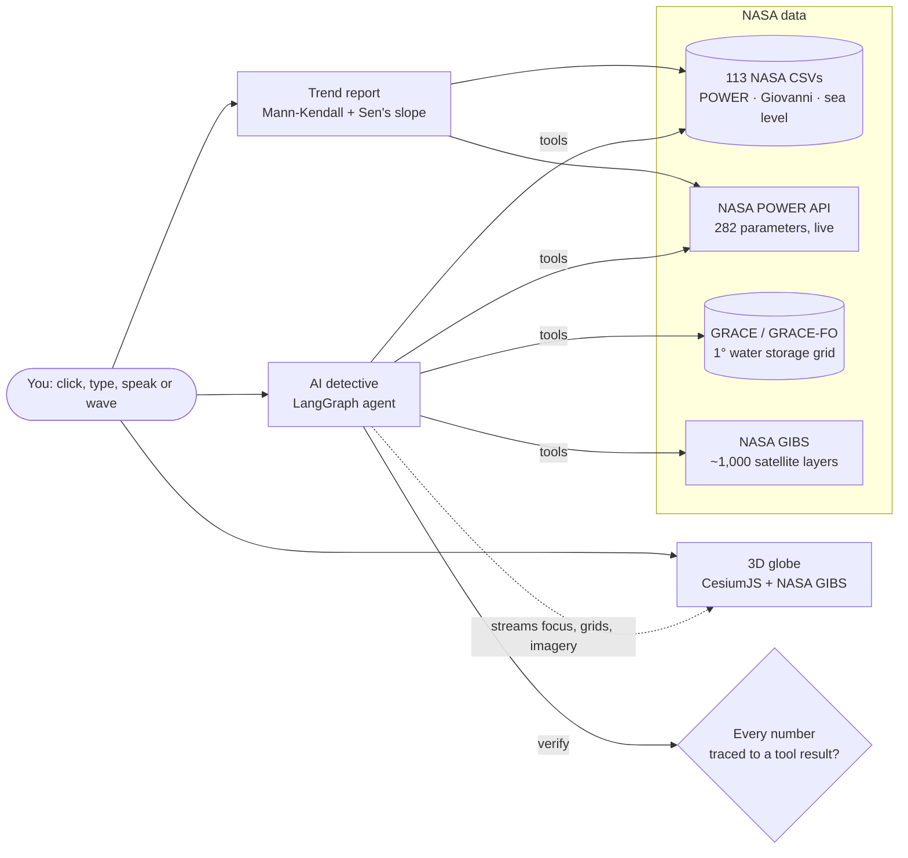

# 🌍 Earth Trend Detective

**NASA Space Apps Challenge 2026 · [Be An Earth System Trend Detective!](https://www.spaceappschallenge.org/)**

Pick any place on a 3D globe and ask a question: *is it getting hotter? drier? hazier? is the groundwater running out?* The app plots NASA's record for that place, tests whether the change is a real trend or could be chance, and says the answer in plain words.

     

---

## ✨ What it does

### The five steps of the challenge, on one screen

| Step | In the app |
|---|---|
| 1. Choose a variable | Temperature, rainfall, vegetation, haze, drought, groundwater, sea ice, sea level |
| 2. Choose a region | ~40 preset places (India in depth, continents, oceans, the whole world), or **type any place on Earth**, fetched live from NASA POWER |
| 3. Choose the period | A two-handle year slider, plus any single season (summer only, monsoon only…) |
| 4. See the time series | Yearly dots, a trend line, warming-stripes and a "then vs now" satellite split on the globe |
| 5. Test significance | **Mann-Kendall test + Sen's slope**, p < 0.05, with a plain verdict: *"Very likely real"* or *"Could be chance"* |

### Beyond the brief

- 🤖 **AI detective:** ask anything in plain words, typed or spoken. A LangGraph agent with ~20 tools plans the evidence and pulls NASA data for any area on Earth. It answers with charts and a verdict.
- ✅ **Number check:** every number in an answer is traced back to the NASA data the agent fetched. The screen shows *"All N numbers trace back to the NASA records"* or lists the ones that don't.
- 🛰️ **Any NASA satellite layer:** the detective can measure any of ~1,000 NASA GIBS layers (NDVI, sea temperature, NO₂, snow, aerosols, night lights…). It decodes the map's colour palette back into real values and runs the same trend test.
- 🔲 **Grid scans:** tests every ~0.5° cell over a region and paints a live heat map on the globe of where things are changing. Hover a square for its number.
- 💧 **Groundwater anywhere:** GRACE/GRACE-FO water storage, clipped to the real border, in mm/decade and km³ lost per year.
- 🔗 **What else changes when…?** Correlations between measures with the seasonal cycle and trends removed, a lag search and an autocorrelation correction.
- 🎙️ **Voice:** offline speech-to-text (Whisper) and spoken answers (Piper). Works with a Bluetooth headset button.
- ✋ **Hand control:** steer the globe with your hand through the webcam (MediaPipe, runs in the browser):
  - open hand turns the globe;
  - a pinch zooms;
  - a sideways pinch slides the before/after line.
- 📄 **PDF report** of any investigation, with charts and sources.
- 📚 **Six one-click stories,** including the challenge author's own example: summer smoke over Wisconsin.

## 🧪 The statistics

| Method | Answers | Why this one |
|---|---|---|
| **Mann-Kendall test** | *Is it really changing?* | Non-parametric: no assumption of a straight line or normal data, robust to outliers |
| **p-value < 0.05** | *How sure are we?* | The challenge author's own rule |
| **Sen's slope** | *How fast?* | Median of all pairwise slopes, so one extreme year can't pull it. Reported per decade |
| Yearly / per-season values | Avoiding fake trends | The seasonal cycle can't create a trend; a missing month is filled with its long-term mean |
| Pearson r, detrended anomalies | *What moves together?* | Effective-n correction for autocorrelation, lag search 0–3 months with a penalty, partial correlation for a third factor |

**Sanity checks** (full record):
- World warming is +0.16 °C/decade; the Arctic is +0.44 °C/decade, about 2.7× faster.
- Punjab water storage is −337 mm/decade, about 3.2 km³ of water lost per year.

## 🏗️ How it works



**How the detective puts things on the globe:** the server streams the answer to the browser. Alongside the text, the tools send small hidden messages that only the globe reads (the model never sees them):

| Message | What the globe does |
|---|---|
| `data-focus` | Flies to the area, dims the rest of the world and locks corner brackets on it |
| `data-grid` | Paints each tested cell as a heat-map square |
| `data-imagery` | Lays a real NASA satellite map over the area, or a then/now split |

**How it finds data:**
- NASA POWER publishes a catalogue of 282 monthly parameters. The detective searches it by meaning ("snow depth" → `SNODP`), fetches the record and runs the trend test.
- Regions are fetched as tiled regional grids, because POWER allows one parameter and a 2°–10° box per request.

## 🛰️ Data sources

All data is real NASA data. Nothing is modified except area averaging, NetCDF → CSV conversion and unit conversion.

| Source | What we use |
|---|---|
| **NASA POWER** (Langley Research Center) | Temperature, rainfall, humidity, soil wetness, aerosols and 282 other parameters, 1981–2025, live for any place |
| **NASA GES DISC via Giovanni** | MERRA-2 air temperature and sea ice, GPM IMERG rainfall, MODIS Aqua aerosol, GLDAS groundwater, MOPITT CO |
| **NASA PO.DAAC** | NASA-SSH global mean sea level (satellite altimetry, 1993→) |
| **NASA JPL GRACE / GRACE-FO** | Mascon RL06.3 land water storage (2002→) |
| **NASA GIBS / Worldview** (EOSDIS) | Satellite maps on the globe and as measurements: MODIS NDVI, land surface temperature, MUR SST, OMI NO₂, VIIRS night lights… |

Place outlines and names come from © OpenStreetMap contributors (Nominatim). How each file was obtained: [`public/trend_detective_data/README.md`](public/trend_detective_data/README.md).

## 🚀 Run it

You need **Node.js 20+**.

```bash
git clone https://github.com/Atharv714/earth-trend-detective.git
cd earth-trend-detective
npm install          # also copies the Cesium and MediaPipe runtimes into public/
cp .env.example .env # add your keys (see below)
npm run build && npm start   # http://localhost:3000
```

What needs which key:
- **No keys needed:** the globe, the reports, the trend tests, the stories and hand control. They run from the files in `public/trend_detective_data/`, offline.
- **Internet only:** live place search (NASA POWER).
- **A key in `.env`:** the AI detective.

| Variable | For |
|---|---|
| `AI_GATEWAY_API_KEY` | The AI detective (Vercel AI Gateway) |
| `PARALLEL_WEB_SEARCH_KEY` | Web search inside the detective's answers (optional) |
| `VOICE_URL` | Address of the voice service (optional; defaults to the local one) |

**Voice (optional):**
- Run `npm run voice` next to the app.
- The first run sets up a Python environment and downloads Whisper and Piper. After that it works offline.
- On a Mac, install `whisper-cpp` first: `brew install whisper-cpp`.

**Shortcuts:**

| Key | Does |
|---|---|
| `⌘K` | Search places |
| `⌘J` | Open the detective |
| `⌘1`–`⌘8` | Switch questions |
| `H` | Hand control |
| `Space` (hold) | Talk |
| `Esc` | Back to the whole Earth |

## 📁 Project structure

```
src/
├── app/                  Next.js app router + API routes (chat, router, voice proxy)
├── components/
│   ├── globe/            Cesium globe, heat maps, satellite splits, hand control
│   ├── report/           Trend report: stripes, charts, seasons, correlations
│   ├── chat/             The detective panel, answer blocks, PDF report
│   └── charts/           bklit chart components
└── lib/
    ├── series.ts         Mann-Kendall, Sen's slope, seasonal aggregation
    ├── coupling.ts       Correlation analysis
    ├── live.ts           Any place on Earth via NASA POWER
    ├── agent/            LangGraph detective: tools, NASA POWER, GRACE, GIBS decoding, number check
    ├── router/           Fast voice-command router
    └── voice/            Mic capture, headset button, speech playback
public/trend_detective_data/   113 NASA CSVs + GRACE grid
voice/                    Python voice service (Whisper + Piper)
scripts/                  Data preparation (GRACE → grid) and setup
docs/HANDOFF.md           Full technical notes
```

## 👥 Team

| Who | Built |
|---|---|
| **Atharv Rastogi** | Frontend, globe, trend report, AI detective, hand control |
| **Medhangshi Das** | Backend APIs, voice assistant (Whisper + Piper) |

Full technical notes are in [`docs/HANDOFF.md`](docs/HANDOFF.md).

## 📜 License

[MIT](LICENSE). NASA data is public domain; see each source's terms. CesiumJS is Apache-2.0.
